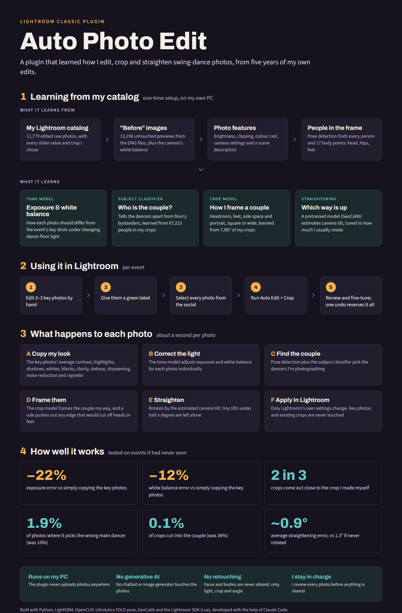
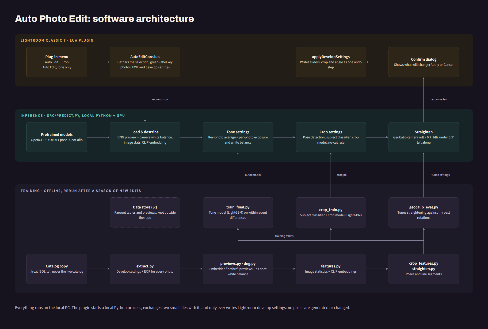

# auto-photo-edit

Learn a photographer's Lightroom editing style from their existing catalog and apply it to new photos.

The models predict Lightroom develop settings (white balance, tone, presence, sharpening, noise
reduction, vignette, dehaze), a crop framed around the dancing couple and a straightening angle from
the unedited photo and its EXIF data. A Lightroom plugin applies the predicted settings, so every
edit stays non-destructive and adjustable. Everything runs locally; no pixels are generated.

Target: Lightroom Classic 7.0 (process version 2012 sliders), Windows.

## Architecture

The graphics' sources are `docs/src/*.dc.html`; re-render the PNGs with `python tools/render_docs.py`.

Want to do this for your own catalog? See [docs/build-your-own.md](docs/build-your-own.md).

## Plan

1. **Extract** - read develop settings + EXIF from a *copy* of the `.lrcat` catalog; render a neutral
   "before" image for each photo (DNG embedded preview).
2. **Explore** - which sliders are actually used, and how much settings vary within vs. between events.
3. **Features** - histogram / clipping / colour-cast stats, pretrained image embeddings (CLIP or
   DINOv2), EXIF, and per-event context.
4. **Train** - gradient-boosted trees or a small MLP per slider; white balance predicted relative to
   as-shot. Evaluate on held-out *events*, against preset and per-event-average baselines.
5. **Apply** - Lightroom plugin calls `photo:applyDevelopSettings()` with the predictions.
6. **Hybrid mode** - photographer edits 2-3 key shots per event; the model adjusts the rest relative
   to them.

## Lightroom plugin

**Install (once):** File > Plug-in Manager > Add > select `lightroom/AutoPhotoEdit.lrplugin`.
The plugin calls `.venv/Scripts/python.exe src/predict.py` in this repo, using `models/autoedit.pkl`.

**Use, per event:**
1. Edit 1-3 representative photos by hand (no need to crop the others first).
2. Give those key photos a **green label** (press `8`).
3. Select all photos of the event in Grid view.
4. Library > Plug-in Extras > **Auto Edit + Crop from Key Photos (green label)** > Apply
   (or **... tone only** to skip cropping).

The other photos get the key photos' average settings (tone, presence, sharpening, noise
reduction, vignette); exposure and white balance are adjusted per photo by the model. Photos that are
not cropped yet get a crop framed around the dancers, straightened using GeoCalib's estimate of the
camera roll (camera-rotated shots and photos with nobody detected are left uncropped). Key photos and existing crops are never changed;
one Ctrl+Z undoes the whole batch. Progress shows in Lightroom's activity bar while the models run.

**Try again with different key photos:** change which photos are green, select the event and run
**Auto Edit + Crop: redo from key photos**. Photos still as the plugin left them are fully redone
(including their crop). A crop you adjusted by hand is kept. If you changed a photo's tone by hand
since its last auto edit, the plugin asks whether to keep it or redo it too. This works after
restarting Lightroom, when Ctrl+Z is no longer available.

**Catalog fields:** every auto-edited photo records *Auto edited* (date) and *Auto edit mode* in the
catalog (never in the image files). Show them with the Metadata panel's **Auto Photo Edit** tagset, or
filter by them in the Library Filter bar (Metadata). A hidden field stores the values applied, which
is how redo recognises hand edits. When the plugin first loads with these fields, Lightroom asks to
update the catalog; that's expected.

**Updating the plugin:** File > Plug-in Manager > Auto Photo Edit > Reload Plug-in.
`python tests/test_plugin.py` runs the plugin's Lua against a fake Lightroom.

**Retrain** after a season of new edits: re-run `extract.py`, `previews.py`, `features.py`,
`crop_features.py`, then `python src/train_final.py <data_dir> models/autoedit.pkl` and
`python src/crop_train.py <data_dir> --save models/crop.pkl`. `train.py` / `crop_train.py` print the
held-out evaluation.

## Offline by default

Every pipeline script switches its own process offline (`src/offline.py`): Hugging Face Hub offline with
telemetry off, Ultralytics offline (no online probe, so no analytics or automatic downloads), and a
network guard that blocks and logs any other outbound connection. Nothing system-wide is changed.
Models load from local caches; the only part that uses the network is the explicit
`python tools/update_models.py --all` (downloads/refreshes CLIP, YOLO pose and GeoCalib weights).
`python tests/test_offline.py <request.json>` runs the real prediction with the network blocked and
checks it matches a normal run. Results are deterministic: the same request gives the same numbers.

## Experiments

* [Which image embedding?](docs/experiments/embedding-comparison.md) - hand-engineered features vs CLIP
  ViT-B/32, CLIP ViT-L/14 and DINOv2 on identical held-out events, with per-event confidence intervals,
  runtime/memory and a detailed crop-failure analysis. Production stays on CLIP ViT-B/32.

## Data

Nothing personal is committed: catalogs, photos, extracted datasets (`data/`) and models
(`models/`) are git-ignored. Always work from a catalog copy - never write to the live catalog while
Lightroom is open.

## Tools

`tools/` holds catalog maintenance scripts (diagnose and relink missing folders).
